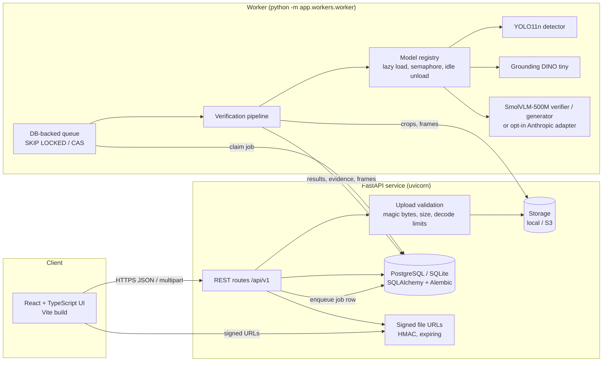
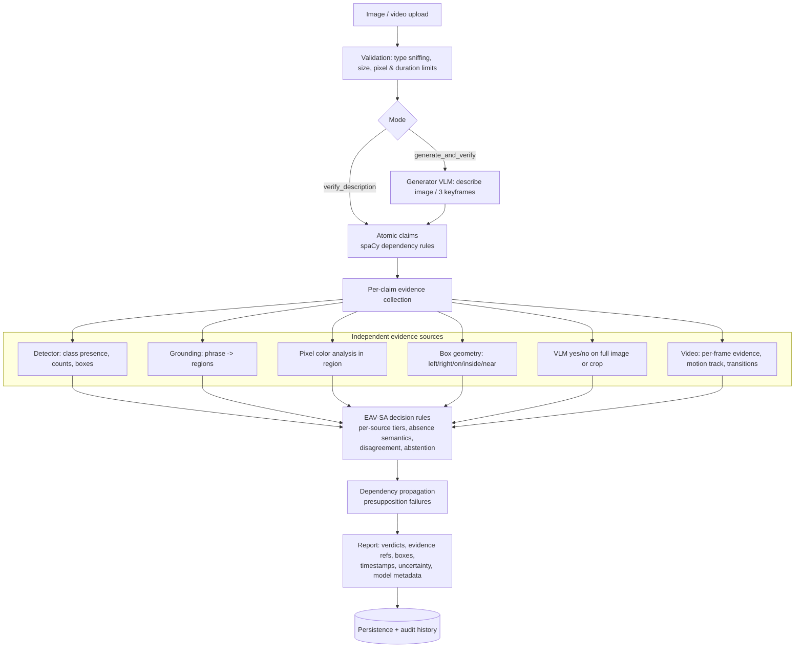

# Architecture

## System overview

In development the API can run the worker in-process (`RC_WORKER_MODE=inline`); in Docker Compose the API and
worker are separate containers so only the worker loads models (≈4.2 GB peak RSS on CPU).

## Verification pipeline

### Module map (`backend/app`)

| Module | Responsibility |
|---|---|
| `core/` | settings (`RC_*` env vars), safe image decoding, quality indicators |
| `schemas/` | Pydantic models: claims, evidence, verdicts, API payloads |
| `claim_extraction/` | rule-based extractor over a spaCy parse + lexicons (COCO classes, colors, relations, verbs) |
| `detection/`, `grounding/`, `vlm/` | model adapter interfaces + real implementations (Ultralytics, transformers, Anthropic) |
| `services/fake_models.py` | deterministic fakes for tests and labelled DEMO mode |
| `services/model_manager.py` | lazy, shared model lifecycle, device selection, inference semaphore, idle unload |
| `analysis/` | model-free evidence: HSV color bins, 2-D box geometry |
| `verification/` | evidence collector, decision engine (EAV-SA), policy/calibrator, pipeline orchestration |
| `video/` | OpenCV probing/validation, uniform / interval / scene-aware sampling, temporal verification |
| `persistence/` | SQLAlchemy engine/session and ORM models |
| `workers/` | DB queue, job runner (timeouts, cancellation, retries, failure classification), worker loop |
| `api/` | FastAPI routers, auth, rate limiting, error envelope |
| `evaluation/` | dataset adapters, metrics, baselines/ablations harness |
| `observability/` | JSON logging, request/job correlation IDs, secret redaction |

### Key design decisions

1. **Generation and verification are separated.** Generated text only reaches the claim extractor. The verifier VLM
   receives narrow questions built from structured claim fields, never the generated paragraph. When the same local
   weights serve both roles, the report says so, and the detector, grounding model and pixel analysis act as
   independent checks.
2. **Raw confidences are never mixed.** Each source maps its native score to a *tier* (strong / weak / none) using its
   own thresholds; only tiers are combined.
3. **Absence ≠ contradiction.** A missing detection is recorded as `absent` and weighs at most −0.35. A contradiction
   needs an explicit contradicting observation (e.g. VLM "no", pixels of a different color, boxes on the wrong side),
   and poor image quality blocks absence-based contradictions.
4. **Overlap ≠ interaction.** Box geometry can only *rule out* contact (clearly separated boxes); overlap is neutral.
5. **Abstention is first class.** `INSUFFICIENT_EVIDENCE`, `REVIEW_REQUIRED` (strong cross-source conflict) and
   `UNVERIFIABLE` (subjective, mental-state, speculative or instruction-like text) are explicit outcomes.
6. **DB-backed queue instead of Redis.** Jobs are enqueued in the same transaction that creates them; PostgreSQL's
   `FOR UPDATE SKIP LOCKED` lets several workers claim jobs safely. Redis would duplicate state that already lives
   transactionally in the database, so it was deliberately not added.
7. **Models load once per process**, lazily, guarded by a lock; inference is bounded by a semaphore
   (`RC_MAX_CONCURRENT_INFERENCE`, default 1) to protect memory on CPU-only machines.

### Job lifecycle

`queued → running → completed | failed | cancelled`

- The worker heartbeats `locked_at` at every stage. Jobs whose worker died are re-queued after
  `RC_WORKER_STALE_LOCK_SECONDS`, up to `RC_JOB_MAX_ATTEMPTS`, then marked `failed` (`worker_lost`).
- Failures are classified: validation / decode / model-unavailable / timeout / cancelled are terminal; unexpected and
  storage errors are retried. Errors are stored (redacted) in `processing_errors`.
- Cancellation is cooperative: checked between stages and between claims.
- Result persistence is idempotent: a retry deletes partial results from earlier attempts first.
